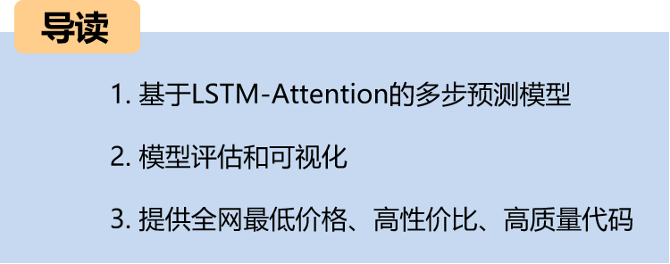
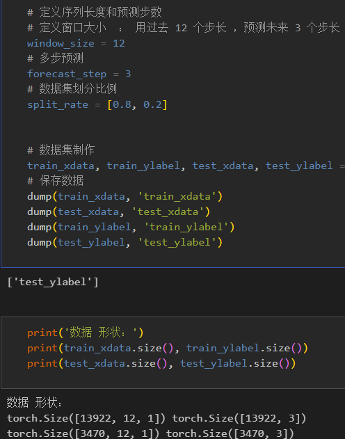
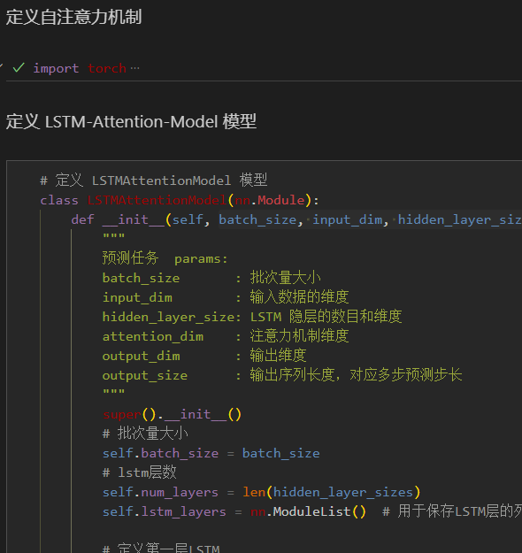
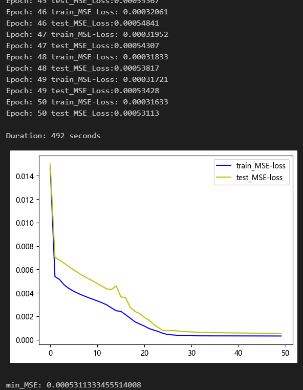
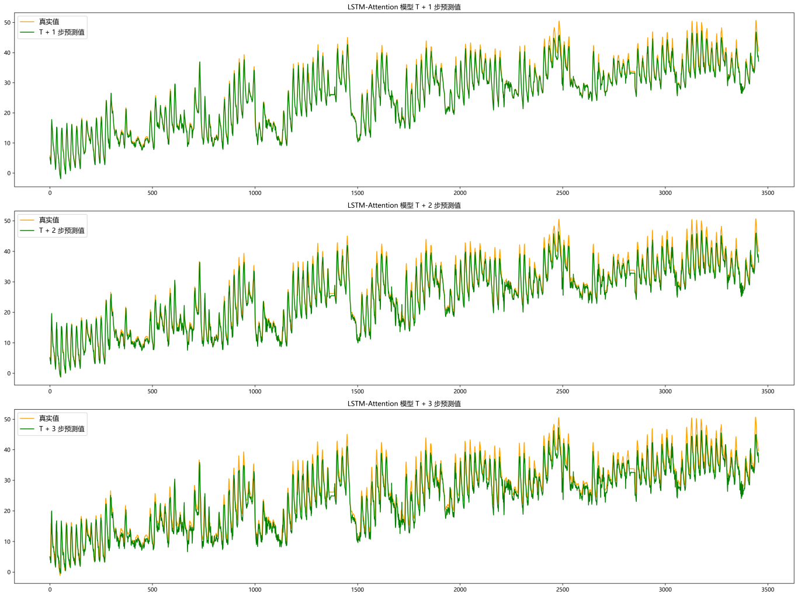
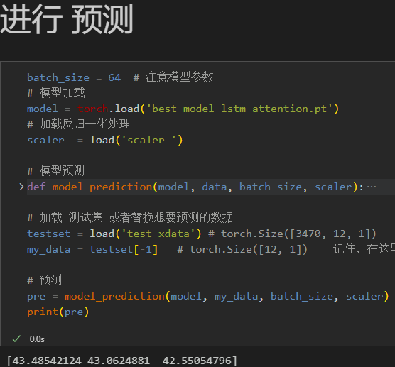
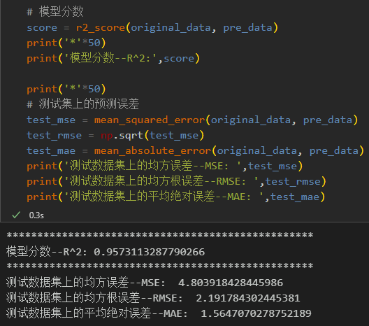
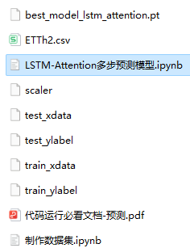

# LSTM-Attention Multi-Step Prediction Model

Environmental Framework: Python 3.9, PyTorch 1.8 and above are all compatible for running.

Usage: This is suitable for those who need to write papers or graduation projects.

Code Guarantee: The code is detailed with comments, ready to run without modification.

This includes complete process data processing:
- Multi-step prediction dataset creation, data loading, model definition, parameter setting, model training, model testing, prediction visualization, multi-step prediction, model evaluation.

Code and File Introducing:
Preface:
This paper introduces a multi-feature, multi-step prediction model based on the LSTM-Attention network, which is based on the power transformer (data set attached at the end).

Detailed introduction of the power transformer dataset can be found in the following text:
Power Transformer Data Set Introduction and Preprocessing
1. Power Transformer Data Preprocessing and Visualization
1.1 Importing data
1.2 Multi-step prediction preprocessing
2. LSTM-Attention Based Multi-variable Multi-step Prediction Model
2.1 Define LSTM-Attention Network Model
2.2 Set parameters and train the model
50 epochs, MSE is 0.0005311, the LSTM-Attention multi-step prediction model has significant prediction effect, the model can fully extract the temporal and spatial features of the sequence, converge quickly, performance is excellent, prediction accuracy is high, appropriately adjusting the model parameters can further improve the model prediction performance.
Note adjustments:
- You can increase the number of LSTM layers and the number of neurons per layer;
- Change the attention dimension number, add more epochs (be careful not to overfit);
- Change the sliding window length (set a suitable window length)
3. Results Visualization and Prediction, Model Evaluation
3.1 Prediction results visualization
3.2 Load the model for prediction
3.3 Model Evaluation
Previously excellent content:
Time Series Forecasting: Analysis and comparison of LSTM, ARIMA, Holt-Winters, SARIMA models
Wind Speed Forecasting (Part 1): Introduction to the dataset and preprocessing
Wind Speed Forecasting (Part 2): EMD-LSTM model based on Pytorch
Wind Speed Forecasting (Part 3): EMD-LSTM-Attention model
Wind Speed Forecasting (Part 4): EMD-Transformer model based on Pytorch
Wind Speed Forecasting (Part 5): EMD-CNN-LSTM model based on Pytorch
Wind Speed Forecasting (Part 6): EMD-CNN-GRU parallel model based on Pytorch
CEEMDAN + Combination Forecast Model (BiLSTM-Attention + ARIMA)
CEEMDAN + Combination Forecast Model (CNN-LSTM + ARIMA)
CEEMDAN + Combination Forecast Model (Transformer - BiLSTM + ARIMA)
CEEMDAN + Combination Forecast Model (CNN-Transformer + ARIMA)
Multi-feature variable sequence forecasting (Part 1): CNN-LSTM wind speed forecasting model
Multi-feature variable sequence forecasting (Part 2): CNN-LSTM-Attention wind speed forecasting model
Multi-feature variable sequence forecasting (Part 3): CNN-Transformer wind speed forecasting model
Multi-feature variable sequence forecasting (Part 4): Transformer-BiLSTM wind speed forecasting model
Multi-feature variable sequence forecasting (Part 5): CEEMDAN+CNN-LSTM wind speed forecasting model
Multi-feature variable sequence forecasting (Part 6): CEEMDAN+CNN-Transformer wind speed forecasting model
Prediction Model Based on the Particle Swarm Optimization Algorithm SSA: CEEMDAN-BiLSTM-Attention
Prediction Model Based on the Particle Swarm Optimization Algorithm SSA: CEEMDAN-Transformer-BiGRU
Superior Prediction Model: Secondary Decomposition-Combination Prediction
Multi-Feature Variable Sequence Prediction (Part 7) CEEMDAN+Transformer-BiLSTM Prediction Model
Multi-Feature Variable Sequence Prediction (Part 8) CEEMDAN-SSA-BiLSTM Prediction Model Based on the Particle Swarm Optimization Algorithm
Multi-Feature Variable Sequence Prediction (Part 11) TCN-GRU Prediction Model Based on Pytorch
VMD + CEEMDAN Secondary Decomposition, CNN-LSTM Prediction Model
VMD + CEEMDAN Secondary Decomposition, CNN-Transformer Prediction Model
VMD + CEEMDAN Secondary Decomposition, Transformer-BiGRU Prediction Model
Prediction Model Based on the Particle Swarm Optimization Algorithm SSA: Code All-in-One Kit
Introduction to the Power Transformer Data Set and Preprocessing
 | Sci-Tech 1st Class High Innovation Prediction Model!
END

## Images

<!-- PAYMENT_BLOCK -->

## Get this dataset

- Payment link (Stripe): [Buy now](https://buy.stripe.com/3cs8yP7sY87d0vu9AB)
- Payment QR code: 

<!-- /PAYMENT_BLOCK -->
